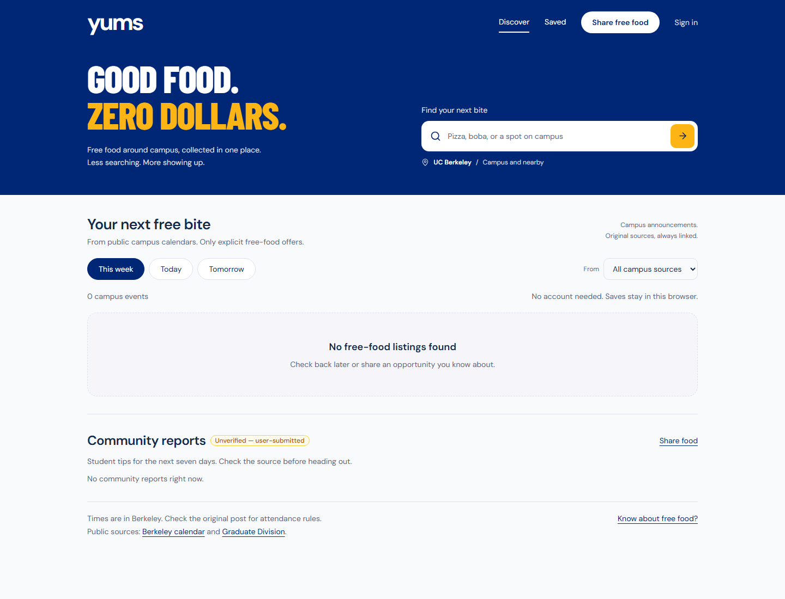

# Yums

Free food at UC Berkeley, collected in one feed from campus calendars and
community tips. See when an event happens, where to go, and the original
announcement before heading out.



## Features

- **One food feed:** public Berkeley Events and Graduate Division calendars,
  filtered for explicit free-food offers and shown in time order.
- **Simple filters:** this week, today, tomorrow, and search by name or location.
- **Saved food:** save in the browser without an account, or sign in to sync new
  saves across devices.
- **Community reports:** signed-in users can share opportunities for operator
  review before they appear publicly.
- **Source transparency:** original announcement links, visible source outages,
  and clearly labeled sample data.

The interface focuses on free food. It does not include a week planner, budget
setup, restaurant browsing, maps, chat, or Calendar connection prompts. Old
`/start` and `/dashboard` links lead to the feed.

## Status

The invited pilot is hosted at [getyums.food](https://getyums.food). The updated
interface and public calendar integration were deployed on October 19, 2026.
Public discovery works without signing in; new accounts require an invitation.

Ed Discussion is a proposed source, not an implemented integration. Its board
access, audience, and permitted event-sharing workflow need to be established.

## Run locally

Requires Node.js 22 and npm 10. From the repository root:

```sh
npm ci
npm run dev
```

Open [localhost:3000](http://localhost:3000). Public food discovery and browser
saves work without credentials. External source outages are disclosed rather
than filled with fabricated offers.

For account saves and submissions, copy `apps/web/.env.example` to
`apps/web/.env.local` and configure your Supabase project URL and public client
key. Google sign-in uses the provider configured in Supabase; ordinary sign-in
does not request Calendar access. See [pilot setup](docs/pilot-setup.md) for
database and account configuration. Never commit local environment files.

For an offline preview, set `YUMS_DEMO_MODE=true` locally and restart. Sample
events stay labeled. Restore `false` for live data; production mode changes
require a rebuild.

For a personal Cal Link preview after signing in on Berkeley's site, see
[local calendar imports](docs/local-callink-import.md). This optional tool keeps
reviewed exports in one browser tab and does not publish them to the pilot.

## Verify

```sh
npm test
npm run test:pilot-config
npm run lint
npm run build
npm run start
```

With the production server running, `npm run check:host` checks health, login
HTML, packaged assets, and callback origin. Signed-in acceptance checks must also
cover account isolation, saving, and report submission.

## Architecture

| Area | Implementation |
| --- | --- |
| Website | Next.js, React, TypeScript, Tailwind CSS |
| Event discovery | Public campus calendar adapters, food evidence extraction, shared source caching |
| Accounts and data | Supabase Auth and PostgreSQL with row-level security |
| Hosting | Docker, AWS EC2, ECR, Caddy HTTPS, CloudWatch, GitHub Actions |

The public food feed skips restaurant lookups and Calendar requests. Source
results are normalized, duplicate listings are collapsed, and expired events
are removed from the visible list. Saved items retain a snapshot of the event.
Existing experimental backend helpers and tables remain for compatibility;
they do not add steps to the current interface.

See [product scope](docs/product.md), [data sources](docs/data-sources.md),
[EC2 deployment](docs/ec2-pilot.md), and the dated
[security review](docs/security-review.md).

## Limits

Coverage is limited to available sources around UC Berkeley. A food announcement
does not establish eligibility or remaining supplies; check the original post.
Cal Link currently requires CalNet sign-in and is excluded from automatic
discovery. Its optional local imports remain private snapshots. Public
calendars can include some of the same events, but their descriptions must
independently establish a free-food offer. See [data sources](docs/data-sources.md).
Community reports are user submitted and are labeled accordingly. The pilot
runs on one server and does not provide high availability.
