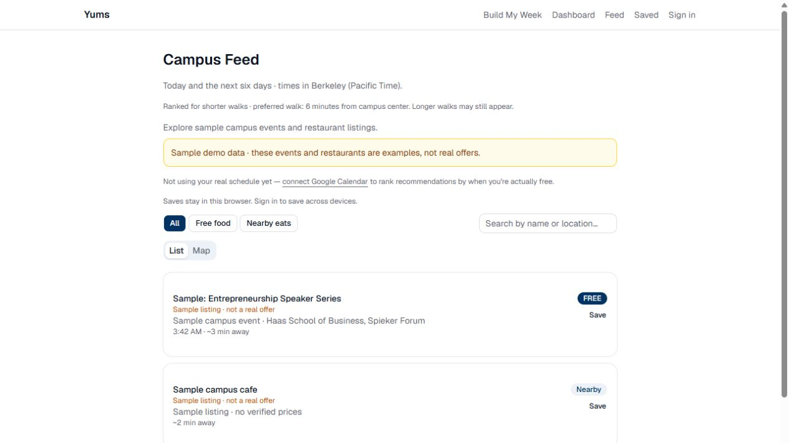

# Yums

Discover free food on campus and nearby places to eat. Yums brings campus event
feeds, personal availability, and saved recommendations into one place, starting
with UC Berkeley.



[Mobile preview](docs/screenshots/feed-mobile.jpg) ·
[Architecture](docs/architecture.md) · [Data sources](docs/data-sources.md) ·
[Roadmap](docs/roadmap.md)

## Features

- **Live discovery:** Berkeley and Cal Link events, filtered for explicit
  free-food offers and linked to the original listings.
- **Personal recommendations:** ranking by free-food preference, walking time,
  and Google Calendar availability when connected.
- **Saved items:** browser-local saves for guests and account-backed saves for
  signed-in users.
- **Community reports:** food opportunities reviewed by an operator before
  appearing publicly.
- **List and map views:** search, filter, and browse events and nearby restaurants.
- **Account access:** Google sign-in, synchronized preferences, and private user
  data protected by database row-level security.

## Project status

Yums is preparing for an invitation-only Berkeley pilot. Live discovery and
account persistence are implemented. The pilot is deployed at
[getyums.food](https://getyums.food). New accounts require an invitation.

The AWS template has passed local schema checks, Guard rules, and account-aware
pre-deployment validation. Public health, packaged assets, and callback-origin
checks pass. Hosted signed-in acceptance checks remain in progress. See the
[EC2 deployment guide](docs/ec2-pilot.md) for costs, configuration, release
checks, and recovery procedures.

## Run locally

Requires **Node.js 22** and **npm 10**. Run commands from the repository root.

```sh
npm ci
npm run dev
```

Open [localhost:3000](http://localhost:3000). Public discovery and guest saves
work without integration credentials. External sources may be unavailable;
the interface reports failures rather than substituting sample offers.

To enable integrations, copy `apps/web/.env.example` to `apps/web/.env.local`
and fill in the settings you need:

| Integration | Configuration | Purpose |
| --- | --- | --- |
| Supabase | Public project URL and publishable/anon key | Sign-in, preferences, saves, and reports |
| Google Calendar | Provider consent and server-side OAuth refresh credentials | Availability-aware ranking |
| Mapbox | Public token | Map rendering |
| Chat provider | Optional server-side API key | Source-grounded replies with a deterministic fallback |

Keep server credentials in local or protected runtime configuration. Never
commit environment files or pass server credentials as Docker build arguments.
See [pilot setup](docs/pilot-setup.md) for database and authentication setup.

For an offline walkthrough, set `YUMS_DEMO_MODE=true` in the local environment
file and restart. Sample listings are labeled and stay separate from live data.
Return the flag to `false` for live discovery. Production mode changes require
a rebuild.

## Build and verify

```sh
npm test
npm run test:pilot-config
npm run lint
npm run build
npm run start
```

With the production server running, use a second terminal to check health,
login HTML, packaged assets, and the callback origin:

```sh
npm run check:host
```

`npm run check:pilot` and `npm run check:supabase` check configuration and public
connection readiness. These complement signed-in acceptance tests; they do not
establish account isolation or end-to-end integration behavior.

## Architecture

| Layer | Implementation |
| --- | --- |
| Web application | Next.js 16, React 19, TypeScript, Tailwind CSS |
| Discovery | Campus-source adapters, OpenStreetMap, cached source results |
| Ranking | Shared scoring logic, walking estimates, optional Calendar availability |
| Accounts and persistence | Supabase Auth and PostgreSQL with row-level security |
| Deployment | Docker, AWS EC2, ECR, Caddy HTTPS, CloudWatch, GitHub Actions |

Source adapters normalize listings and extract food evidence. Shared scoring
produces recommendations for the feed, dashboard, and chat. Public source
caches are separate from per-user Calendar data.

```text
apps/web/                  Pages, UI components, and API routes
services/event-ingestion/  Campus-source adapters and food evidence extraction
packages/shared/           Shared types and recommendation scoring
packages/database/         Schema, migrations, and database audits
infra/                     AWS template, Guard rules, and release script
scripts/                   Configuration, packaging, and host checks
docs/                      Architecture, source coverage, and pilot operations
```

## Scope and limitations

Current coverage focuses on UC Berkeley. Walking times are estimates from
campus center. Source listings may change, and an explicit food offer does not
establish attendance eligibility or remaining availability. Check the original
event details before attending.

Restaurant listings do not include verified prices, discounts, or nutrition.
Budget settings are preferences; Yums does not track spending or actual savings.
Browser reminders require an open feed tab. The planned single-server pilot
does not provide high availability.
